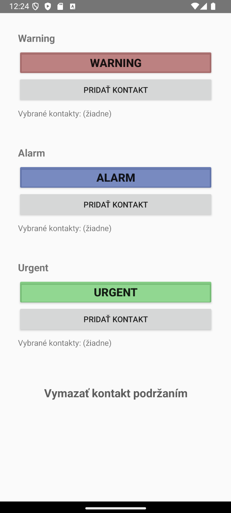
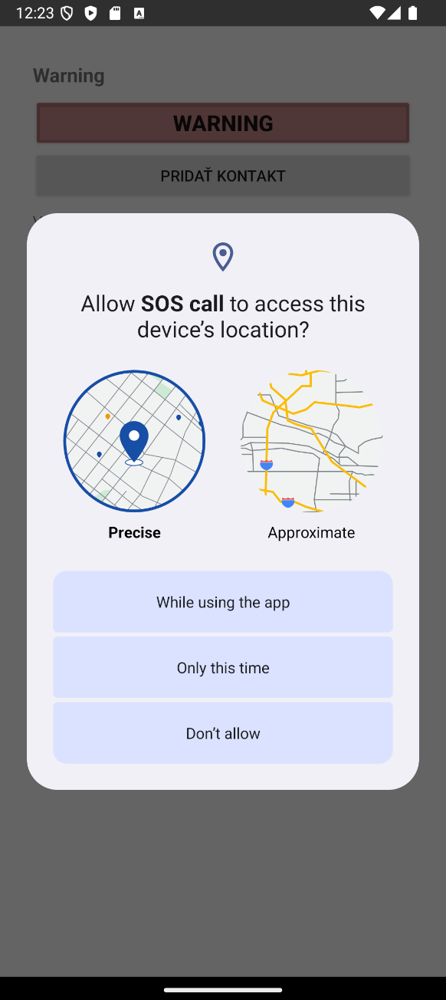

# SOS-App

An Android application developed in **Kotlin** for sending emergency SMS messages with GPS and GSM location information.

The app allows users to select emergency contacts and send predefined alerts based on three emergency levels.

## Features

- Three emergency levels: **Warning, Alarm, and Urgent**
- Select up to **3 emergency contacts**
- Send SMS messages with GPS coordinates and GSM network information
- Select recipients directly from phone contacts
- Request location and SMS permissions

## Screenshots

| Main screen | Location permission |
|:---:|:---:|
|  |  |

## Technologies

- **Kotlin** – Android application development
- **Android SDK** – application framework
- **XML** – user interface layouts
- **LocationManager** – GPS location
- **TelephonyManager** – GSM network information
- **SmsManager** – SMS functionality

## About

Developed as a university project focused on Android development, location services, and SMS communication.

**Note:** This is an educational project and has not been fully tested across different Android devices. It should not be relied upon for real emergencies.
